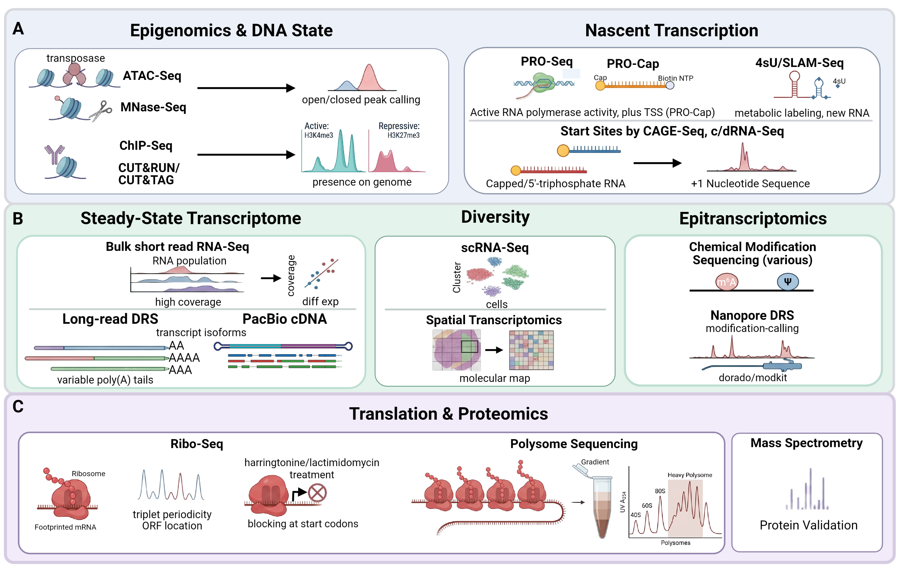

*Multi-omic approaches for investigating transcription, RNA processing, and translation.* Sequencing- and mass spectrometry-based methods organized according to the biological layer interrogated. **(A)** Approaches for assessing chromatin state, nascent transcription, transcriptional dynamics, and transcription start site (TSS) usage, including ATAC-Seq, MNase-Seq, ChIP-Seq, CUT&RUN/CUT&TAG, PRO-Seq, PRO-Cap, 4sU/SLAM-Seq, CAGE-Seq, and c/dRNA-Seq. **(B)** Methods for characterizing mature RNA populations, including short- and long-read RNA sequencing, single-cell and spatial transcriptomics, and RNA modification profiling. **(C)** Techniques to evaluate translation and protein production, including Ribo-Seq, polysome sequencing, and mass spectrometry. Created with BioRender, and published in our overview article in the Journal of Virology.
