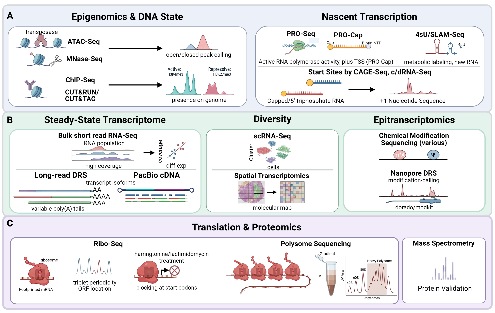

*Multi-omic approaches for dissecting transcription, RNA processing, and translation.* Overview of sequencing- and mass spectrometry-based methods for profiling gene expression at each step from chromatin state to protein output, organized by the biological layer they interrogate. **(A)** Techniques involving nuclei, temporal transcription responses, and accurate transcription start sites. Assay for Transposase‑Accessible Chromatin (ATAC)-Seq and Micrococcal Nuclease (MNase)-Seq use transposase insertion or nuclease digestion, respectively, to map open versus closed chromatin via peak calling. Chromatin Immunoprecipitation (ChIP)-Seq and Cleavage Under Targets and Release Using Nuclease (CUT&RUN) / Cleavage Under Targets and Tagmentation (CUT&TAG) use antibody-based enrichment to localize histone marks or DNA-binding proteins genome-wide, distinguishing active (e.g., H3K4me3) from repressive (e.g., H3K27me3) chromatin states. Precision Run‑On (PRO)-Seq maps engaged polymerase position and orientation; PRO-Cap additionally captures capped 5′ ends to define transcription start sites (TSS) at nucleotide resolution. 4‑thiouridine (4sU) / Thiol‑linked Alkylation for Metabolic labeling (SLAM)-Seq uses metabolic labeling with 4-thiouridine to distinguish newly synthesized from pre-existing RNA. Cap Analysis of Gene Expression sequencing (CAGE)-Seq and circularization-based/differential RNA-Seq (c/dRNA-Seq) enrich for capped or 5′-triphosphorylated RNA to define TSS usage genome-wide. **(B)** Techniques for evaluating the mature RNA pool of a sample. Bulk short-read RNA-Seq provides high-coverage quantification of the RNA population for differential expression analysis. Long-read direct RNA-Seq (DRS) and Pacific Biosciences (PacBio) cDNA sequencing resolve full-length transcript isoforms and variable poly(A) tail lengths that short-read approaches cannot capture. Single-cell RNA-Seq (scRNA-Seq) resolves transcriptional heterogeneity between individual cells via clustering; spatial transcriptomics preserves positional information to generate a molecular map of gene expression across tissue architecture. Chemical modification sequencing (various protocols) detects specific RNA modifications such as m⁶A and pseudouridine (Ψ) via induced misincorporation or chemical tagging. ONT DRS enables modification-calling directly from raw current signal (e.g., using dorado/modkit) without chemical treatment. **(C)** Techniques to measure translational activity and polypeptide production. Ribo-Seq maps ribosome-protected mRNA footprints to identify actively translated open reading frames via triplet periodicity; treatment with initiation inhibitors such as harringtonine or lactimidomycin causes initiating ribosomes to accumulate at or near start codons while allowing elongating ribosomes to run off, enabling precise mapping of translation initiation sites. Polysome sequencing separates mRNAs by ribosome loading via sucrose gradient sedimentation (monitored by UV A₂₅₄ absorbance), enriching for heavily translated transcripts. Mass spectrometry provides orthogonal validation of protein products at the proteome level. Created in BioRender.
